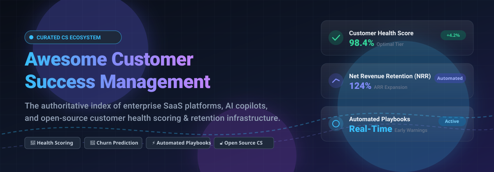

  

# 🚀 Awesome Customer Success Management

  
  
  
  
  

> 🌟 **A curated directory of SaaS customer success platforms and open-source tools for account health scoring, predictive churn analytics, onboarding automation, and lifecycle retention management.**

**Last updated: November 2026** 📅

---

## 📑 Table of Contents

- [📊 Sector Overview & Market Dynamics](#-sector-overview--market-dynamics)
- [🏢 SaaS/Hosted Platforms](#-saashosted-platforms)
- [💻 Open-Source GitHub Projects](#-open-source-github-projects)
- [🤝 How to Contribute](#-how-to-contribute)
- [💖 Support & Sponsorship](#-support--sponsorship)
- [📈 Star History](#-star-history)
- [⚠️ Disclaimer](#️-disclaimer)

---

## 📊 Sector Overview & Market Dynamics

The Customer Success Management (CSM) software market is estimated at approximately $2.2B to $2.7B in 2025–2026, expanding at an annual growth rate (CAGR) of over 20% toward $3.4B+ as recurring revenue businesses prioritize net retention and churn reduction over pure acquisition. The sector is moderately concentrated at the top—anchored by established pure-play pioneers (Gainsight, ChurnZero, Totango) and massive CRM ecosystems (HubSpot, Salesforce)—surrounded by a fragmented long tail of specialized point solutions for customer telemetry, onboarding, and self-hosted tooling.

---

## 🏢 SaaS/Hosted Platforms

| Platform | Company Size (Valuation / Revenue) | Pricing | Free Tier / Trial Limits | Description & Key Strengths |
| :--- | :--- | :--- | :--- | :--- |
| **[HubSpot Customer Success Tools](https://www.hubspot.com/)** | ~$12B+ Market Cap (NYSE: HUBS) / ~$3.1B+ ARR | Paid Service Hub starts at $15–$20/seat/mo (Starter); CS features require Professional tier at $90–$100/seat/mo + onboarding | Free forever tier available: Capped at 2 users, 1,000 contacts, 1 shared inbox, 3 canned snippets, 1 meeting link, and community-only support | CS tools integrated directly within Service Hub; best for teams already running on HubSpot CRM. Health scoring is basic compared to pure-play platforms. |
| **[Gainsight](https://www.gainsight.com/)** | $1.1B Valuation (Vista Equity acquisition) / ~$200M+ ARR | Starts at ~$150/user/month (annual contract ~$30,000/year minimum) | No free tier; free trial on website is restricted to Product Experience (PX) only (CS platform requires guided demo / pilot) | Enterprise category leader with deep health scoring, AI copilots (Atlas), and automated playbooks; requires ~5 month implementation. |
| **[Planhat](https://www.planhat.com/)** | ~$550M Valuation ($50M Series A) / ~$25M–$33M ARR | Starts at $1,150/month (billed annually, ~$13,800/year minimum) for Start-Up plan with unlimited seats | No free tier and no self-serve free trial; access requires a vendor demo and guided proof-of-concept (POC) | Highly configurable customer platform offering unlimited user seats and modern data-layer modeling across customer journeys. |
| **[Totango](https://www.totango.com/)** | ~$150M+ Total Funding / ~$40M ARR (Merged with Catalyst) | Starts at ~$1,000–$1,500/month (typically ~$12,000–$18,000/year annual contract) | No free tier and no self-serve free trial; evaluation requires demo request and sales-assisted trial/pilot | Enterprise customer retention and product-led growth platform; features modular composable CS architecture. |
| **[Catalyst](https://catalyst.io/)** | ~$65M+ Total Funding / ~$10M–$20M ARR (Merged with Totango) | Starts at ~$500/month (annual agreements starting ~$6,000–$12,000/year) | No free tier and no self-serve free trial; sandbox access granted via sales consultation | Customer growth and collaboration platform with intuitive UI and bidirectional CRM sync; merged with Totango under Great Hill Partners. |
| **[ChurnZero](https://churnzero.com/)** | ~$35M Total Funding / ~$25M–$50M ARR | Starts at $12,000/year ($1,000/month billed annually) for entry tier | No free tier and no self-serve free trial; evaluation requires a scheduled consultation and live product demo | Real-time health scoring, customer journeys, and automated playbooks optimized for mid-market and SMB SaaS teams. |
| **[Vitally](https://www.vitally.io/)** | ~$40M+ Funding ($30M Series B) / ~$15M–$25M ARR | Starts at $299/month for starter tier; higher tiers scale via custom annual contracts | 14-day free trial available (sandbox environment accessed through sales-assisted signup); no permanent free tier | Modern, collaborative CS platform with built-in AI copilots, customer-facing docs/portals, and flexible real-time integrations. |
| **[ClientSuccess](https://www.clientsuccess.com/)** | Bootstrapped / Seed-funded / ~$10M–$15M ARR | Starts at $15,000/year ($1,250/month billed annually) | No free tier and no self-serve free trial; platform evaluation is provided via scheduled sales demo and guided POC | Structured customer onboarding, success scores, and renewal tracking designed for growing mid-market B2B teams. |
| **[Custify](https://www.custify.com/)** | Bootstrapped / Private / ~$2.7M ARR | Starts at $899/month (entry plan typically covering up to 3 CSM users) | No permanent free tier; 14-day guided trial/sandbox provided upon request via sales demo | Agile CS platform tailored for B2B SaaS businesses wanting automated health scoring, KPI tracking, and rapid setup. |
| **[SmartKarrot](https://www.smartkarrot.com/)** | Early Stage / ~$1.1M Funding / ~$1M–$5M ARR | Starts at $15,000/year (or entry plans starting at $499/user/month) | No free tier and no self-serve free trial; access requires a scheduled personalized product demo | Blends customer success management with product engagement analytics, account surveys, and automated playbooks. |

---

## 💻 Open-Source GitHub Projects

The open-source customer success landscape comprises specialized CRM foundations, customer support hubs, lifecycle notification orchestration, and emerging CS portals. The projects below are sorted by GitHub Stars_Counts (descending):

### 1. **[Twenty](https://github.com/twentyhq/twenty)** 
- **Description**: A modern, open-source CRM alternative to Salesforce designed for AI-native workflows. Provides powerful relational customer tracking, extensible custom objects, and real-time event subscriptions suited for custom customer health scoring pipelines.
- **Tech Stack**: TypeScript, NestJS, React, PostgreSQL.
- **Best For**: Engineering-first teams building tailored CSM dashboards and customer relationship lifecycle trackers.

### 2. **[Chatwoot](https://github.com/chatwoot/chatwoot)** 
- **Description**: Omnichannel customer engagement and support desk platform (alternative to Intercom and Zendesk). Enables customer success managers to coordinate live customer conversations, track user sentiment, and centralize communication histories across email, live chat, WhatsApp, and social media.
- **Tech Stack**: Ruby on Rails, Vue.js, PostgreSQL, Redis.
- **Best For**: Managing real-time customer support interactions and qualitative health signals.

### 3. **[SuiteCRM](https://github.com/SuiteCRM/SuiteCRM)** 
- **Description**: Enterprise-grade open-source customer relationship management platform. Supports end-to-end account management, contract and SLA tracking, renewal workflows, and custom reporting modules for enterprise retention tracking.
- **Tech Stack**: PHP, Symfony, MariaDB/MySQL.
- **Best For**: Self-hosted enterprise deployments requiring on-premise data sovereignty and extensive SLA compliance auditing.

### 4. **[Dittofeed](https://github.com/dittofeed/dittofeed)** 
- **Description**: Open-source customer engagement and automated lifecycle messaging engine (alternative to Customer.io). Powers automated customer success playbooks, onboarding sequences, churn prevention nudges, and account milestone alerts triggered by user telemetry.
- **Tech Stack**: TypeScript, ClickHouse, Node.js, Temporal.
- **Best For**: Automating event-driven customer success playbooks and onboarding engagement without leaking user PII to external vendors.

### 5. **[CXM-Tool](https://github.com/antigravitysoham-eng/CXM-Tool)** 
- **Description**: Full-stack Customer Experience (CX) management portal. Features interactive portfolio dashboards (Gross/Net Retention, Churn Risk, upcoming Renewals), customer directories, proactive account health checks, contract lifecycle tracking, and an AI assistant analyzing NPS and health metrics.
- **Tech Stack**: React 19, Vite, Express, SQLite, JWT auth.
- **Best For**: Developers seeking a reference architecture or foundational template for a dedicated self-hosted CX/CS portal.

---

## 🤝 How to Contribute

Contributions are welcome and appreciated! To propose a new platform or update existing entries:

1. 🍴 **Fork the repository**.
2. 🌿 **Create a new branch** (`git checkout -b feature/add-platform`).
3. 📝 **Add or update entries** following the established format (ensure exact starting prices, free tier limits, and verifiable data).
4. 🚀 **Submit a Pull Request** with a concise description of your additions.

⭐ Star the repository if you find it helpful!

---

## 💖 Support & Sponsorship

If you find this curated directory helpful for your customer success workflows, research, or architecture planning, consider supporting the project:

- ⭐ **Star** this repository to increase visibility and support open discovery.
- 🍴 **Fork** and share it with fellow CS leaders, RevOps specialists, and developers.
- ☕ **Buy a Coffee / Sponsor**: Support ongoing maintenance and research on the [GitHub Sponsor Dashboard](https://github.com/sponsors/ishandutta2007).

Your backing ensures this resource remains comprehensive, transparent, and up-to-date! 🙌

---

## 📈 Star History

---

## ⚠️ Disclaimer

- This is a **community-curated** list — not exhaustive and not an endorsement.
- Customer success platforms handling account health and revenue data must comply with data protection regulations (GDPR, CCPA, etc.) and implement appropriate access controls.
- **The "enterprise CS platform" vs. "mid-market CS platform" vs. "CS module" vs. "open-source project" distinction is critical.**
  - **Gainsight, Totango, and Catalyst** are enterprise CS platforms—deep health scoring, playbooks, and AI, but quote-only with long implementation cycles.
  - **ChurnZero, Vitally, ClientSuccess, Custify, and SmartKarrot** are mid-market CS platforms—faster deployment and published entry pricing models.
  - **HubSpot Customer Success Tools** is a CS module within Service Hub—ideal for CRM consolidation.
  - **Twenty, Chatwoot, SuiteCRM, Dittofeed, and CXM-Tool** provide open-source primitives for CRM, engagement, support, and lifecycle automation for teams requiring full data sovereignty.
